# 上班啟示錄：下班先鬥牛（2v2／3v3）

《上班啟示錄》的番外（原名「午休鬥牛」，v0.4.5 改名）：上班族、香香籃球隊、山頂國小隊在頂樓、廟口球場打半場鬥牛。挑 1～3 個人組隊，電腦控制你的隊友和對手。每個人都有自己的大招和招牌動作。

> **選角開放 11 人**：上班族小葵、阿傑、小米、Vivi、Kevin，香香籃球隊林語彤、元小雨、胡姬，山頂國小隊兔兔老師、校長、小編（`js/main.js` 的 `ROSTER`）。其他 6 人（小燕、黑輪、德哥、Momo、阿哲、小偵）先藏起來，只在 3v3 對手湊不滿時由電腦補。

**立繪**：開放的 8 個人都有真人風立繪（使用者給的照片當參考，GPT 畫）。放大招時過場是那個人的大招立繪；灌籃、三分、後仰跳投、抄截成功時，旁邊也會滑進一張對應動作的立繪。大招**不用 3D 特寫**：v0.4.0 曾放回每人專屬的特寫運鏡，使用者看過還是覺得 3D 模型拉近很可怕，v0.4.6 關掉（`main.js` 的 `CLOSEUP = false`，運鏡程式還留著）；大招就是一般比賽鏡頭＋2D 立繪過場。

**介面風格（v0.5.0）**：「街頭鬥牛傳單」——墨黑、米白紙、火焰橘、訊號黃，紙紋（SVG 雜訊）＋網點，硬邊陰影、斜體粗字、膠帶貼紙，英文小標用 Anton。封面底圖是大合照轉雙色調＋網點，上面是 GPT 火焰標題字（`tools/gen_logo.sh` → `art/logo.webp`）；選角卡像印刷卡（角色色網點底）；拿掉 emoji 圖示（SP／SKILL 小標取代）。使用者說原本的粉彩漸層、大圓角「太 Claude、太 AI」。樣式都在 `index.html` 最後的 `<style id="flyer">`，比賽中轉播風（`#matchUi`）不動。

**開場 OP（a4 不想上班 製作）**：一打開直接播約 3.6 秒，不用先點：三女對三女大合照（小米、Vivi、小葵 vs 元小雨、林語彤、胡姬）推近，片名砸下來，下面寫「a4 不想上班 製作／友情參戰 香香籃球隊・山頂國小」。點畫面、按「跳過」或電腦按 Esc／Enter／空白鍵都能跳過；還沒點過畫面時瀏覽器不給出聲，就安靜播。v0.5.5 使用者嫌原本 18 秒太長，拿掉了聯名卡和前面 6 顆鏡頭（舊劇照 op3～op8 在 git 歷史裡，`tools/gen_op.sh` 也還能重畫）。劇照 `op/op9.webp`，運鏡、白閃、片名是 `js/op.js` 程式做的；橫式手機、寬螢幕整張劇照置中不切頭。標題畫面可以「再看一次開場」。香香籃球隊、山頂國小是邀請加入的，用「友情參戰」而不是「聯名／授權」。測試：`?noop` 不播開場，主控台 `G.seekOP(秒)` 停在某一格。

**主畫面圖示**：封面最下面可以選小葵、阿傑、林語彤、元小雨當主畫面圖示（會記住；iPhone 換 apple-touch-icon、Android 換成同一張的 manifest），選好再「加入主畫面」。圖示是 `tools/make_icons.py` 直接裁遊戲裡的真人風抄截立繪（不另外畫），配角色色底＋集中線、金色金屬框、右下角籃球徽章，輸出 `icons/<人>-512/192/180.png`（1024 大圖在 `work/icons/`）。

**配樂**：封面、選角、結算放「籃球主題」，比賽中放「籃球音樂」（使用者提供的 mp3，`audio/`）。

**線上玩：** https://pokemonida99.github.io/office-basketball/

免費、不用登入，沒有儲值、等待時間或社群功能。手機直式、橫式、電腦都能玩，都是全畫面：手機按「開打」會自動進全螢幕，右上角 ⛶ 可以切換；iPhone 的 Safari 不支援網頁全螢幕，封面會提示「分享 → 加入主畫面」，從主畫面開就是全螢幕（`manifest.json`）。手機橫放時鏡頭拉寬、比分移到左上角，籃框和整個半場都看得到。

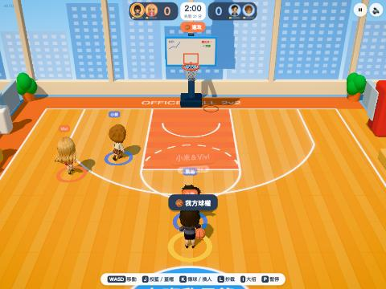

**v0.5.5**：開場縮短成只剩大合照＋片名，一打開直接播；製作名義改「a4 不想上班 製作」，香香籃球隊、山頂國小寫「友情參戰」；橫式手機選角只能左右滑、不能上下拖，小螢幕標題列排成一行。

**v0.5.4 新增**：
- 山頂國小隊三人：兔兔老師（後衛，彩蛋射籃）、校長（變身針筒超人）、小編（前鋒，下班衝刺上籃）。
- 持球時的 ✋ 鍵從「假動作」改成「衝刺」：0.75 秒爆發加速，冷卻 2.2 秒；衝刺中按投籃接切入上籃／急停跳投。
- 中鋒在籃下要球，接到球有機會直接起跳灌籃：叫過球的 75%，沒叫過的 45%。
- 封面改版，拿掉 1～6 的教學說明，改成「教學關卡」。

**v0.4.0 新增**：a4 不想上班 × 香香籃球隊聯名的真人風開場 OP；練習場（自己練投／陪練防守／一打一）和 1v1 模式；大招特寫放回來；比賽中 UI 改成轉播包裝風（設計筆記 `design/ui-polish_設計筆記.md`）；修正橫放手機一打開能上下拖、投籃時機條殘留、延長賽黑輪抽成判輸、中途回選角球場殘留。

## 怎麼玩

- **比賽**：2 分鐘，或先到 21 分的隊伍贏。三分線外進球算 3 分，線內 2 分。時間到平手就打延長賽，下一球得分的贏。
- **球場**：選角畫面可以選「🏢 頂樓」（辦公室頂樓木地板、落地窗看城市）或「🏮 大橋尾」（廟口球場：綠色水泥地、紅色禁區，籃框後面是福德宮，紅柱、彩繪樑、燕尾脊、雙龍搶珠、石獅、冒煙的香爐，兩旁石長椅、紅燈籠、大榕樹、機車、廟口小吃攤，傍晚天空）。全部程式畫的（`js/court.js` 的 `buildTemple`），`setCourt()` 切換，會記住。
- **選角卡**：每個人一張真人風上半身特寫（`tools/make_cards.py` 從全身照裁頭到腰、4:5，臉才看得清楚；舉手的人先跳過上面一段），姿勢各不相同（Vivi 秀高跟鞋單指轉球、小葵舉咖啡夾著球走、阿傑推眼鏡、小米三分出手、Kevin 像發表會介紹產品、林語彤壓低胯下運球、元小雨單手把球舉高、胡姬球滾過肩膀眨眼），`tools/gen_real.sh` 的 `card_*` 生全身照 → `make_cards.py` 裁成 `art/<人>_card.webp`。電腦每排 4 張、直式手機 2 欄、橫式手機瘦長卡排一排（一次看 7 張半，往右滑看其他人）。
- **教學關卡**：封面「教學關卡」用林語彤對阿傑，一步一步帶：移動到黃圈 → 投進 2 球 → 衝刺切入 → 招式＋投籃連招 → 防守抄截或蓋帽 → 放大招。下方橫幅寫要做什麼，要按的鍵會發亮；完成後可以直接「開始比賽」（`TUT`、`tutGo`、`updateTutorial`）。
- **人數與難度**：選角畫面上方可以切 練習／1v1／2v2／3v3 和簡單／普通／困難（會記住）。1v1 先到 11 分（一樣 2 分鐘），沒有隊友所以傳球鍵不能用。
- **練習場**：挑 1 個人進去，沒有時間限制、不會結束。右上角面板切換：
  - 「對手：無」自己練投，投進或球滾太久都會直接回到手上，不用清球；
  - 「對手：陪練防守」電腦只防守、不進攻，搶到球 0.7 秒後傳回給你；
  - 「對手：一打一」正式規則計分，先到 11 分宣布輸贏後重新一局；
  - 「大招無限」開著時大招永遠集滿、一波進攻可以連放；「換對手」換一個陪練／一打一的人；面板上有你的命中率和三分命中。
- **換球權**：進球後由對手從三分線外弧頂發球。搶到防守籃板或抄截之後，要**先把球帶出三分線**才能投籃。
- **操作**：參考《灌籃高手》手遊，**同一顆鍵攻守自動切換**。選角時先點的人就是你整場操作的角色（頭上有黃色「▼ 你」、腳下大黃圈），不會因為誰拿球就換人；鏡頭會同時拍你和球。
- **隊友（電腦）持球時**：🏀、👐、✋ 都變成「要球」（隊友馬上傳給你；你在籃下有空檔時隊友也會主動傳），⚡ 變成「空手切入」。防守時 👐 是「包夾」：叫電腦隊友一起去夾持球的人 2.5 秒。
- **畫面提示**：小提示在左上角、橫幅在下方，不擋球場中間；大招名稱看過場，灌籃、三分看旁邊滑進來的立繪。

| 鍵 | 進攻（持球） | 防守 | 搶籃板（球在空中／地上） | 電腦 |
|---|---|---|---|---|
| 🏀 大橘鍵 | 按住投籃，綠區放開最準 | 蓋帽（自動撲向出手的人） | 搶板（往球跳，籃板範圍看角色） | J／空白 |
| 👐 綠鍵 | 傳球（3v3 看搖桿方向） | 包夾 | — | K |
| ⚡ 橘鍵 | **角色招式**（閃身步、多元進攻、強力突破…） | **按住貼身防守**：扇形干擾、可以「撞停」對手的突破 | **按住卡位**：把對手推出籃下 | U／Shift |
| ✋ 藍鍵 | 衝刺（0.75 秒爆發加速，冷卻 2.2 秒） | 抄截（球彈到地上、對手被撞停時最好抄） | — | L |
| 頭像鍵 | 大招 | 大招 | 大招 | I／E |

- **角色招式**（持球時的 ⚡）：
  - 林語彤「閃身步」：大幅橫移過人，很容易把防守者晃倒，也很難被撞停。
  - 胡姬「多元進攻」：籃下自動轉身上籃、中距離後仰跳投、三分線外後撤步三分。
  - 元小雨「強力突破」：用身體把防守者撞開。她的力量、籃板範圍、蓋帽距離都是全隊最大。
  - 山頂國小：兔兔老師兔子跳步、校長朝會訓話（強力突破）、小編後撤步。
  - 上班族：小葵快步切入、阿傑背身強打、小米換手運球、Vivi 轉身過人、Kevin 後撤步。
- **撞停**：防守的人按住 ⚡ 貼身防守時，對手的突破有機會被撞停（看兩邊力氣）；被撞停的人會踉蹌一下，這時抄截最準。
- **兩鍵連招**（v0.5.3）：突破技或衝刺做到一半（或做完 0.45 秒內）按投籃，接對應出手，投籃鍵會發亮並顯示連招名稱：背身強打／強力突破＋投籃＝籃下轉身上籃（外面變後仰）；後撤步＋投籃＝後撤跳投（自動最佳時機）；換手／閃身＋投籃＝近拉桿上籃、遠急停跳投；轉身過人＋投籃＝近轉身上籃、遠轉身後仰；快步切入／衝刺＋投籃＝切入上籃／急停跳投。電腦也會用（`comboOf`、`runCombo`）。
- **音效**：運球「咚＋啪」（低音往下掉＋手拍球的高頻＋地板回音），跟腳步同步，你的人最大聲、其他人照距離變小；進籃「刷」聲加球落地彈兩下（`js/fx.js`）。
- **位置**：小米、胡姬是**射手**（三分命中率約一般人的 1.5 倍）；小葵、林語彤是**後衛**（跑最快、抄截最強）；阿傑、元小雨是**中鋒**（籃下命中 ×1.25、籃板蓋帽範圍大、力氣大，但三分只有 0.6 倍；籃下出手 85% 灌籃，其他人只有 10%，大多上籃）；Kevin 是**干擾型**：防守時在旁邊一直碎念「這個用 AI 就好…」，被他貼著的人命中率 ×0.75；Vivi 老闆是**顏值擔當**，走到哪都閃亮亮。
- **卡通上色＋描邊**（v0.5.2，參考灌籃高手手遊）：角色材質換成三階光影的 MeshToonMaterial，外面套一層沿法線往外推、只畫背面的深色外殼當描邊（inverted hull，跟本體共用骨架；`js/assets.js` 的 `TOON`），不用後製、手機跑得動。
- **運球**：一步拍一下，節奏跟走路／小跑步／衝刺動作的腳步週期對齊（`stepCycle`）；球在最高點碰到手（手在腰旁往下壓），身體微前傾。
- **防守腳步**：面向持球的人往旁邊移＝防守滑步（`guard` 馬步側跳整段）、往後退＝後退步（`back`，Walk_Fight_Back）；開始／停止有門檻差，不會一直閃。衝刺切入放開搖桿或轉向會**急停**（`stop`，Sprint_and_Sudden_Stop）。
- **細部動作**（Higgsfield 動作庫綁在小米身上，`models/moves/`）：
  - 抄截：往前撲一步、手伸直去掏球（`reach`）。
  - 持球衝刺：拿球推著搖桿直直衝向籃框 0.3 秒，會變成前傾衝刺（`sprint`，跑速 ×1.3）；撞上擺好防守架式的人（你按住防守鍵、或電腦盯球的人）有機會被**撞倒**（`flop`，往後翻倒、球掉出去、1.5 秒爬起來），力氣差越多越容易倒，沒倒就是「撞停」。
  - 被蓋火鍋：有機會連人一起被蓋倒（`knock`），蓋的人力氣越大越容易。
  - 共用動作拿掉了臀部位移，倒地時照原動作的臀部高度曲線（`MOVE_DROP`）把人往下放。
- **大招集氣**：時間會慢慢累積，傳球、得分、助攻、抄截、蓋帽、籃板也會加。
- **大招限制**：大招**只有我方持球（進攻）時才能放**，而且**一波進攻只能放一次**（換球權才算新的一波）。球在你手上時對手不能放大招；集滿了但不能放時，大招鍵會變暗並寫「進攻時用」或「下一波」。電腦也照同樣的規則。

## 大招

| 角色 | 大招 | 效果 | 條件 | 招牌動作 |
|---|---|---|---|---|
| 小葵（新人實習生） | ☕ 咖啡衝刺 | 全隊 6 秒加速，傳球秒到、不會被抄，抄截變強 | 我方持球 | 開心跳 |
| 阿傑（資深設計師） | 📐 設計稿灌籃 | 從起跳點飛到籃框，必進灌籃，三分線外起跳算 3 分 | 我方持球 | 掛在籃框上 |
| 小米（總機客服） | 📞 總機干擾 | 對手頭上電話狂響，暈 3 秒，趁空檔輕鬆出手 | 我方持球 | 講電話 |
| Vivi（老闆） | 👑 老闆說了算 | 籃框變成超大金框 8 秒，我方命中率大增，下一球不管在哪裡投都算 3 分 | 我方持球 | 爵士手 |
| 特助 Kevin | 🤖 用 AI 就好 | 無人機和瞄準環鎖定籃框，雷射瞄準後跳投，站在哪裡投都必進 | 我方持球 | 蹲下比讚 |
| PM 小燕 | 📋 PM 急件 | 對手被急件卡住，隊友衝到籃下，小燕高吊長傳，隊友空中接力灌籃 | 我方持球 | 蓄力長傳 |
| 業務黑輪 | 🤝 業務抽成 | 從對手分數抽走 2 分，對手看傻 1 秒 | 我方持球 | 握拳慶祝 |
| 德哥（財務長） | 📉 預算砍半 | 對手 6 秒跑速減半，大招集氣砍一半 | 我方持球 | 搖手指 |
| Momo（行銷企劃） | 📱 爆紅貼文 | 8 秒內我方每次進球多 1 分，隊友大招 +25%，天上掉愛心 | 我方持球 | 比大愛心 |
| 阿哲（IT 工程師） | 🛡️ 防火牆 | 籃框前立起六角防火牆，7 秒內對手一般投籃全部擋下（效果延續到下一波防守） | 我方持球 | 秀肌肉 |
| 小偵（稽核專員） | 🔍 現場稽核 | 衝去盤查守著持球隊友的防守者，對方愣住 2.5 秒 | 我方持球 | 出拳 |
| **林語彤**（香香籃球隊・後衛） | 💨 瞬影閃身 | Z 字閃過每一個防守者（全部晃倒），最後必進上籃 | 我方持球 | 勝利歡呼 |
| **元小雨**（香香籃球隊・中鋒） | 🏀 禁區女王 | 8 秒內對手的投籃她都飛過去蓋掉，鬆球自動被她吸走（效果延續到下一波防守） | 我方持球 | 擺架式 |
| **胡姬**（香香籃球隊・前鋒） | 🌀 千變萬化 | 假動作騙起所有防守者，再來一記必進後仰跳投 | 我方持球 | 勝利手勢 |
| **兔兔老師**（山頂國小・後衛） | 🥚 彩蛋射籃 | 籃球變成彩色大彩蛋，從哪裡投都必進，三分線外算 3 分 | 我方持球 | 舉手跳 |
| **校長**（山頂國小） | 💉 針筒超人 | 變身 20 秒：換成針筒超人模型（紅披風）、能力全滿；跳起來必蓋（直接飛到出手的人面前）、按抄截直接飛過去抄、投籃必進。時間到變回校長，虛弱 20 秒：走路剩 0.45 倍、被抄一定掉球 | 我方持球 | 加油打氣 |
| **小編**（山頂國小・前鋒） | 🏃 下班衝刺 | 打卡下班的速度直線衝到籃下，路上的人全部撞飛，接必進上籃 | 我方持球 | 勝利歡呼 |

放大招時會播放全螢幕過場（角色大頭照＋招式名＋口頭禪），慢動作約 1 秒，接著角色擺出自己的招牌動作。電腦也會在適合的時機放大招。比賽結束時，贏的一隊會一直擺招牌動作。

**黑財神**：比賽剩 1 分鐘時，黑財神坐著雲飄過球場，撒下三顆金元寶，誰先撿到誰的大招 +40%。

沒上場的同事和上班族會站在兩旁的長椅上加油，進球時一起跳。

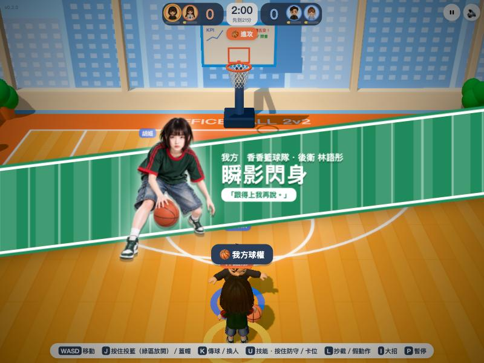

| | |
|---|---|
| 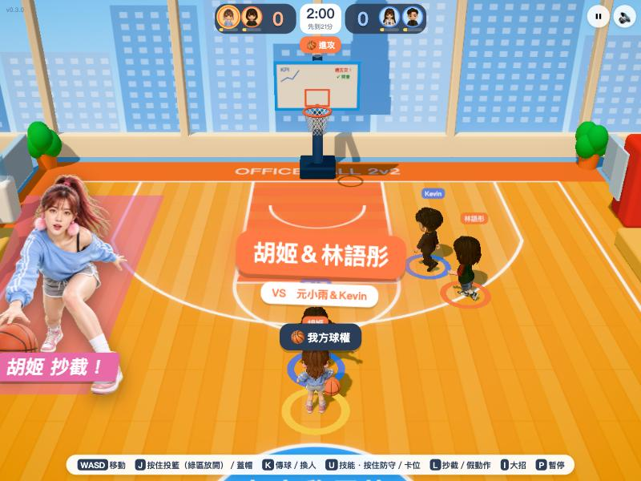 | 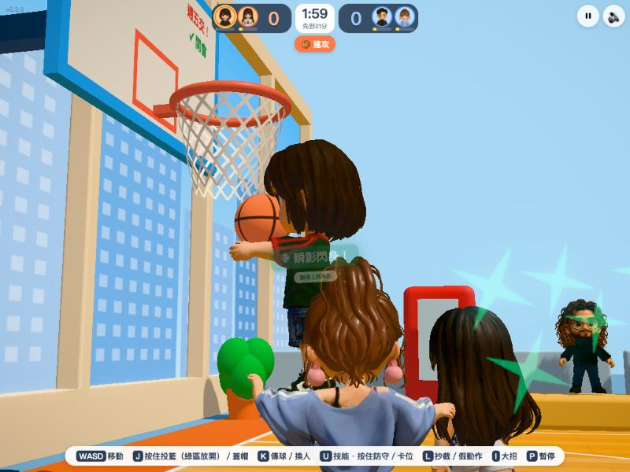 |
| 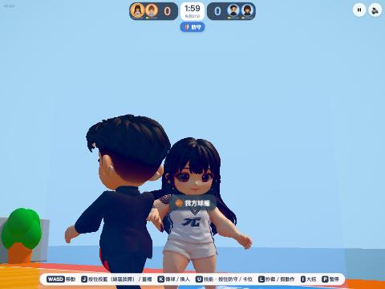 | 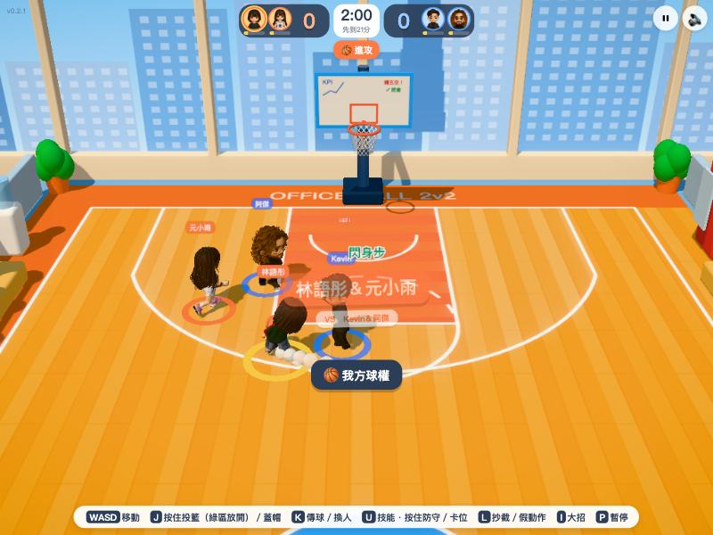 |

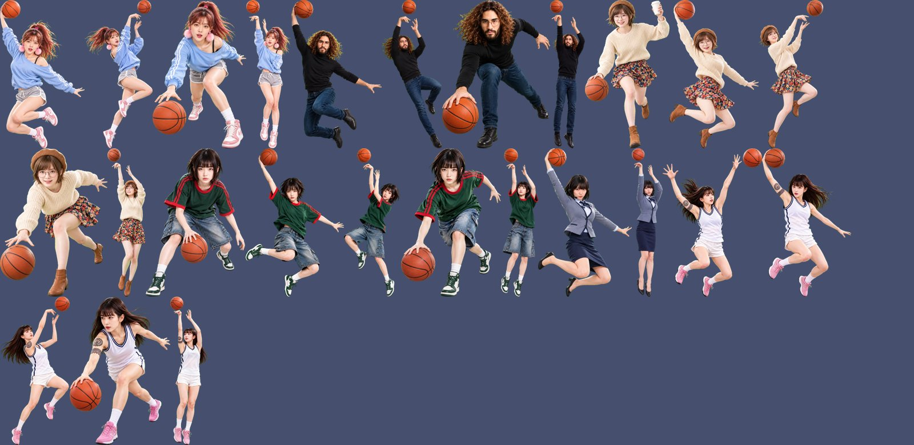
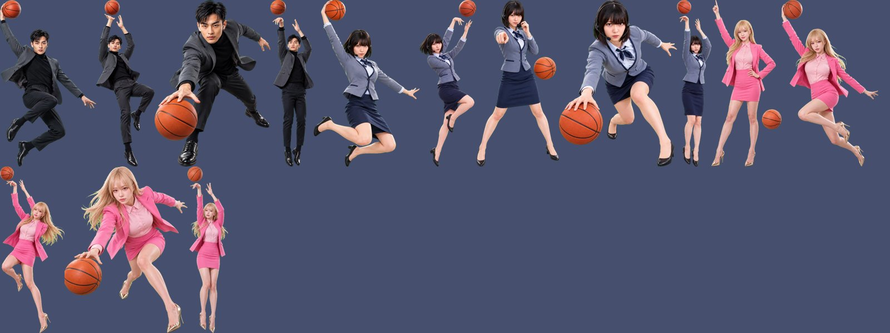

香香籃球隊：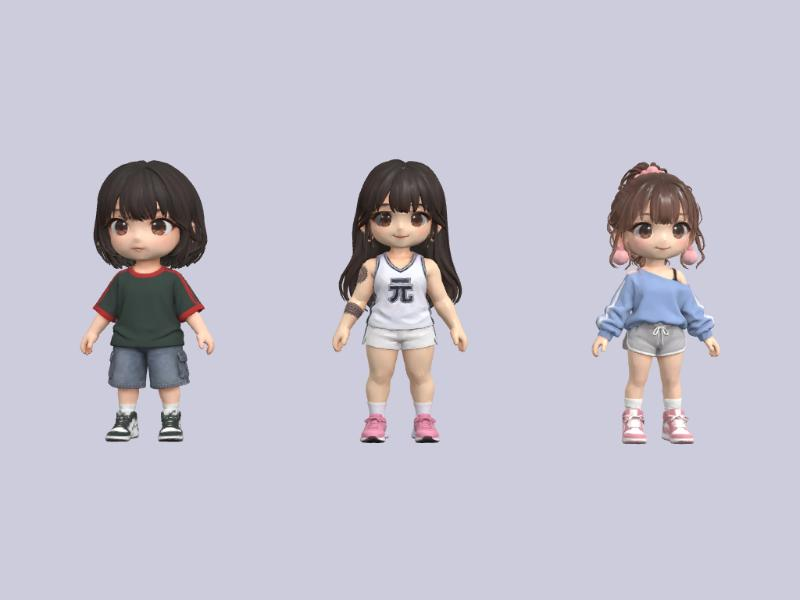

手機五顆鍵：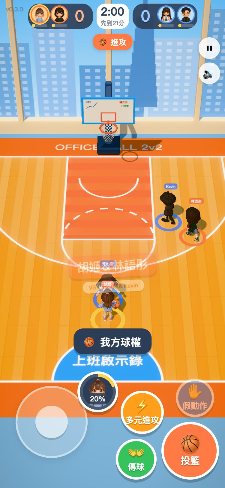

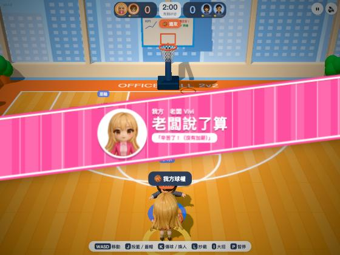

| | |
|---|---|
| 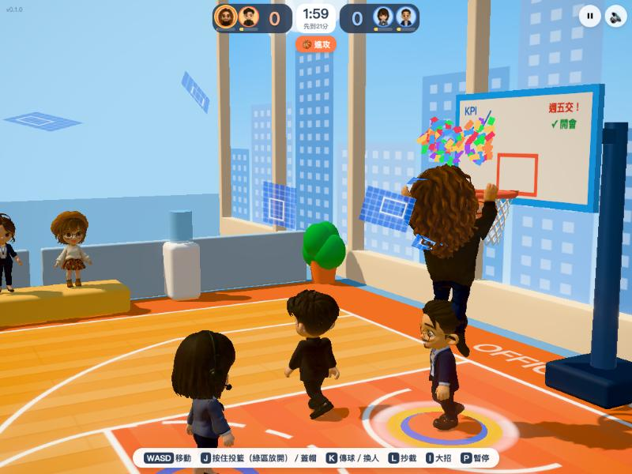 | 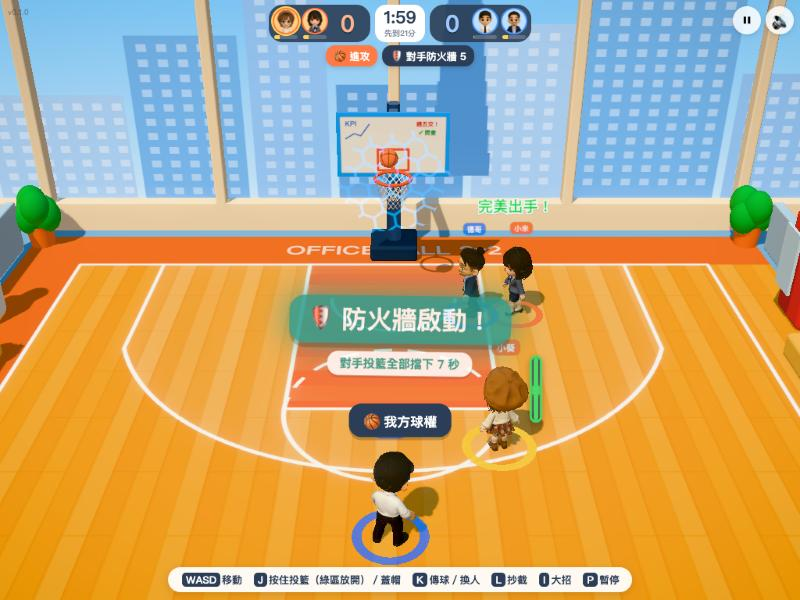 |
| 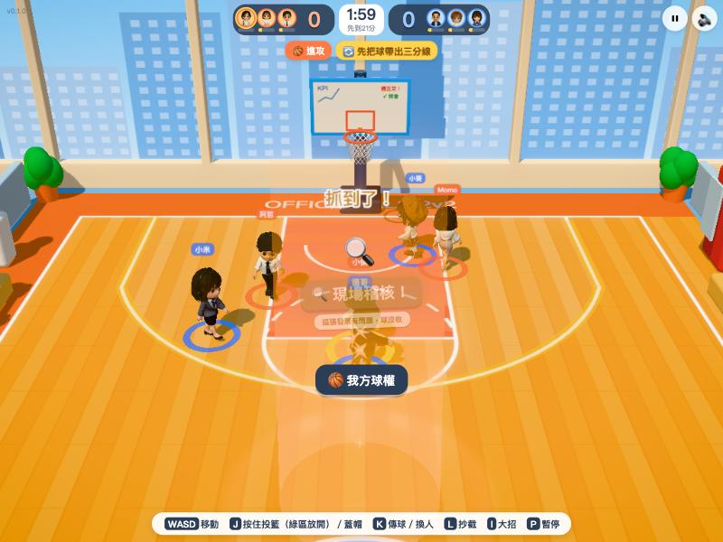 | 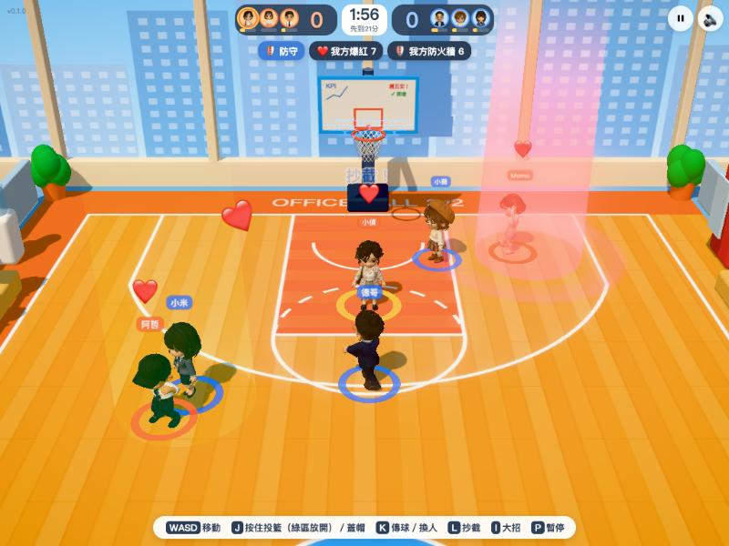 |
| 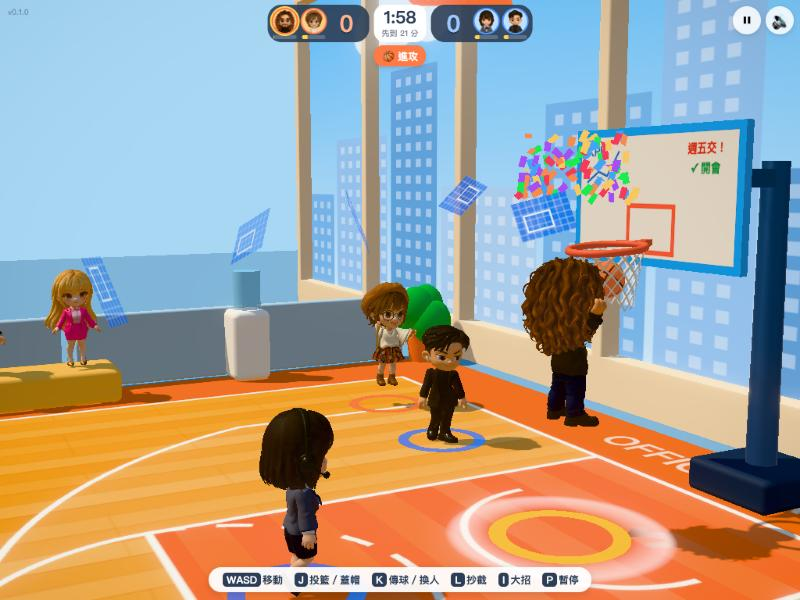 | 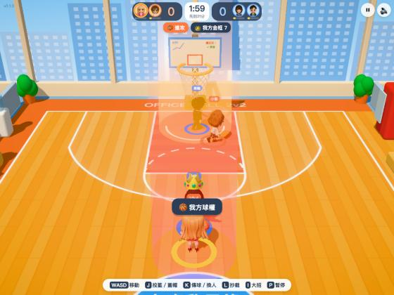 |
| 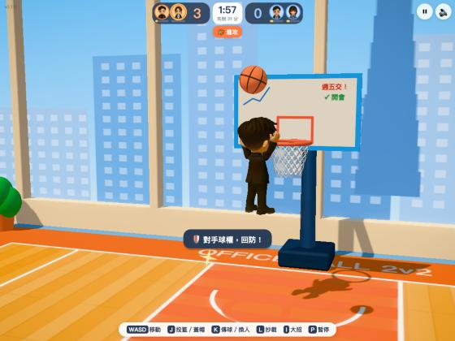 | 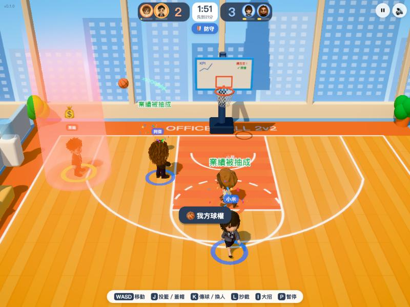 |
| 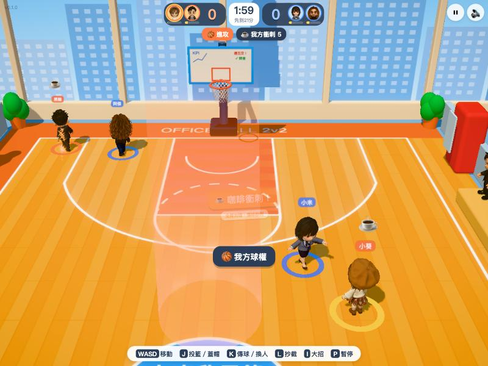 | 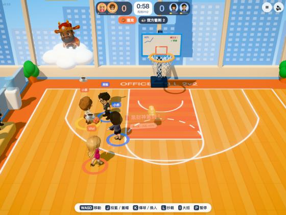 |

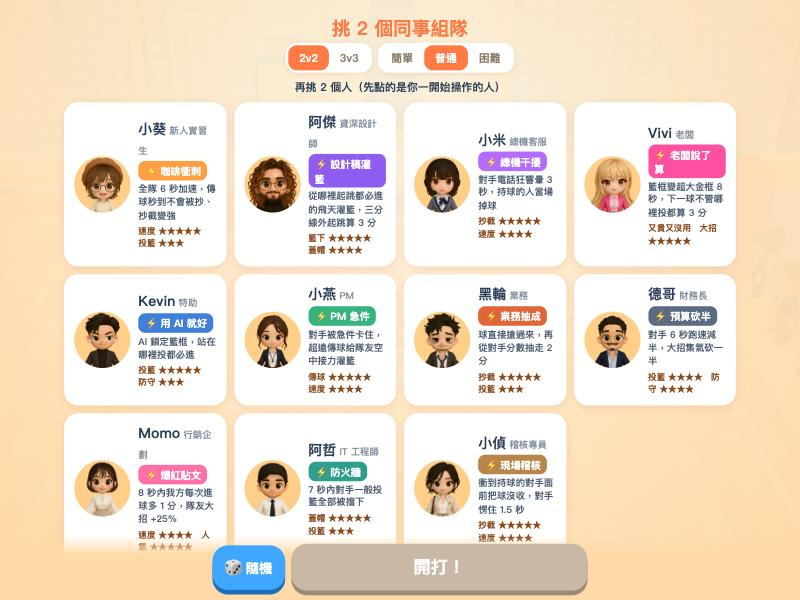

手機：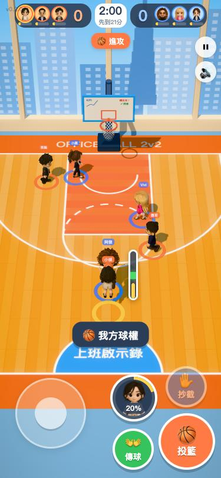  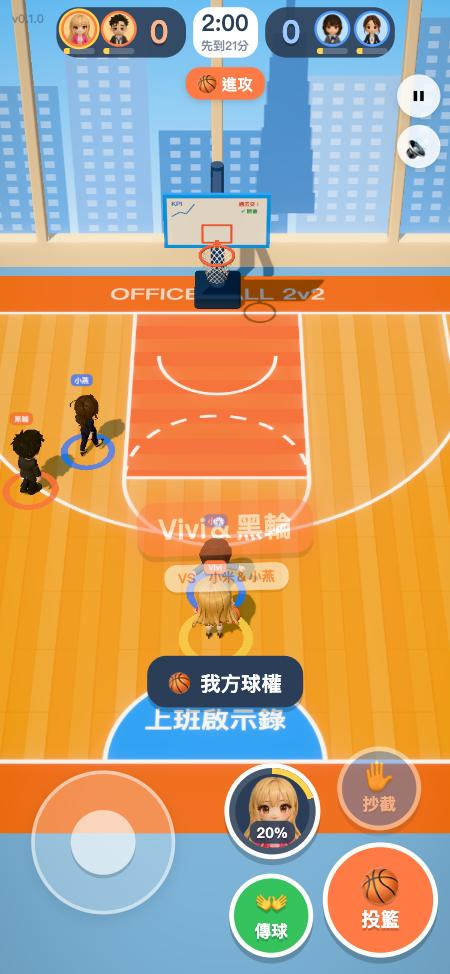 

## 素材

- 原本七個角色的模型沿用《上班啟示錄》`office-apocalypse/models/`（已壓縮、已綁走路／小跑步動作）。
- **新角色**（德哥、Momo、阿哲、小偵）是主遊戲的「備用角色」：GPT 三視圖 → `split_views.py` 切四張 → Higgsfield Tripo 多視角轉 3D → `face_front.py` 轉正 → 綁走路動作（walking_2）→ gltf-transform 壓縮。

  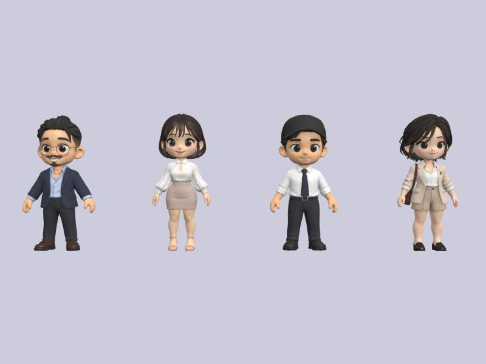
- **招牌動作**：每個角色另外用 Higgsfield `3d_rigging` 綁一段動作庫裡的動作（開心跳、吊單槓、講電話、爵士手、蹲下比讚、蓄力丟、握拳、搖手指、比愛心、秀肌肉、出拳），再用 `tools/strip_anim.cjs` 只留動畫（拿掉模型、Hips 位移照走路骨架縮放、去掉水平位移），存在 `models/sig/`，每個 35～130 KB。遊戲裡套到同一套骨架的角色上，只播精彩的那一段（`SIG_WIN`）。

  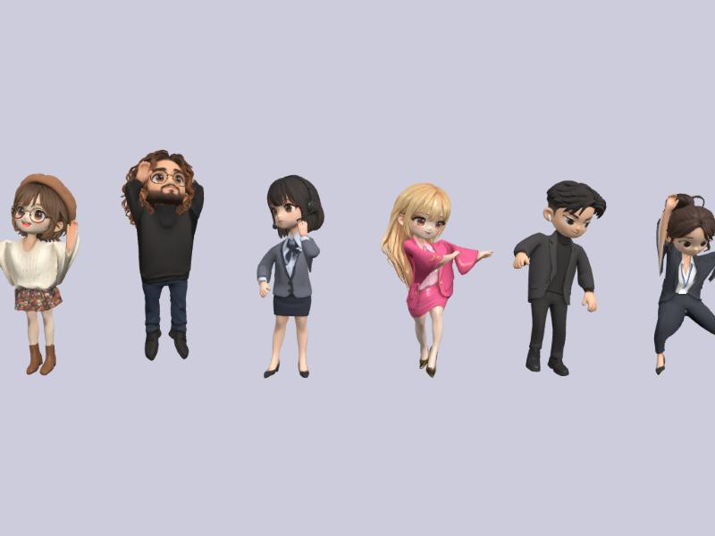
- **山頂國小隊三人＋針筒超人**：使用者給的照片只當造型參考，GPT 畫原創公仔三視圖（`tools/gen_sheets.sh`）→ Tripo 轉 3D → 綁走路、小跑步、招牌動作（`work/3d/proc_rig.sh` 把綁好的檔案壓成 `models/<人>_walk/jog.glb` 和 `models/sig/<人>.glb`）。針筒超人前兩次 Tripo 轉出來背面也長了臉、披風只剩兩側，左右側面圖對調再轉一次才對（背面是紅披風）。
- **香香籃球隊三人**：使用者的照片只裁「沒有臉的服裝」那半邊當造型參考（`tools/gen_sheets.sh`），GPT 畫原創公仔三視圖 → Tripo 轉 3D → 綁走路、小跑步、招牌動作。
- **共用細部動作**（`models/moves/`）：閃身、轉身、後撤步、推人（卡位／強力突破）、踉蹌（被晃倒、被撞停）、搶板、火鍋、灌籃，在小米身上各綁一次，拿掉 Hips 位移（`strip_anim.cjs … flat`）後套給所有人，跳多高由遊戲物理決定。
- **真人風立繪**（`art/*.webp`）：`tools/gen_real.sh` 用使用者給的照片（香香三人的照片、`~/Downloads/人物集` 的上班族三視圖）讓 GPT 畫動作照，純綠背景 → `tools/make_art.sh` 去背轉 WebP（每張 15～55 KB）。Vivi 照主遊戲設定襯衫扣到領口。
- **上半身疊 3D 動作**（`models/moves/guard.glb`、`handsup.glb`、`hop.glb`）：防守蹲低張手、投籃／蓋帽／灌籃雙手舉高、歡呼雙手 V 字，用 Higgsfield 動作庫綁在小米身上（橫向馬步跳、雙手舉高歡呼、舉手跳），遊戲裡只取上半身骨頭（脊椎、肩膀、手臂、頭）的轉動疊在走路／跑步上（`OVER_WIN`、`overlay()`）。以前用程式直接轉手臂骨頭，手抬高時腋下皮膚會被拉長（像蝴蝶袖），動作庫的動作連鎖骨、脊椎一起動就不會。
- 運球、傳球、抄截、暈眩這些小幅度的手臂動作，還是用程式轉骨頭（最多抬到約 90°），加跳躍和壓扁。
- 頭像是載入時用 3D 模型直接拍的大頭照（`makePortraits`），十一個人風格一致，不另外畫圖。
- 音效和配樂全部用 WebAudio 合成（`js/fx.js`、`js/music.js`），沒有音檔。
- 這次 3D 共花約 156 點（4 個新角色轉 3D＋綁走路＋招牌動作 100 點，原本 7 人的招牌動作 56 點）。

## 開發

- 改了 js 之後，要一起改 `index.html` 和各 js 檔 import 後面的 `?v=` 版本號，不然 GitHub Pages 的快取會讓玩家拿到舊檔。
- 純 HTML＋Three.js r170（`vendor/`，本機放好，不連 CDN），不用建置。
- 本機預覽：`python3 tools/serve.py 4460 .`（不快取，改完重新整理就是新版）。也可以在上一層用 launch.json 的 `office-basketball`。
- `js/main.js` 開頭的 `CFG` 是手感數值（比賽時間、目標分數、跑速、抄截、大招集氣），`DIFF` 是三個難度，`CHARS` 是十一個角色的能力和大招說明。
- `js/court.js`：球場、籃架、白板籃板、落地窗；`js/world.js`：渲染、畫質（自動／漂亮／流暢）、鏡頭；`js/assets.js`：角色模型與動畫載入。
- 開不起來的說明卡、手機自動降畫質、擋放大和選取，都跟《打卡衝衝衝》同一套。
- `work/`（不進 git）：三視圖切圖、Tripo 原檔、綁好的原檔。看模型和動畫用 `tools/peek.html`（例如 `tools/peek.html?f=../models/kui_walk2.glb&clips=../models/sig/kui.glb&anim=1&t=1.0`）。
- 測試用：`?play` 直接開打；`?auto` 讓你這隊也交給電腦；主控台的 `G`（`G.start(['kui','jie','mi'], ['de','zhe','zhen'])`、`G.special('zhen')`、`G.step(1/60, 600)`、`G.LOG`）。
